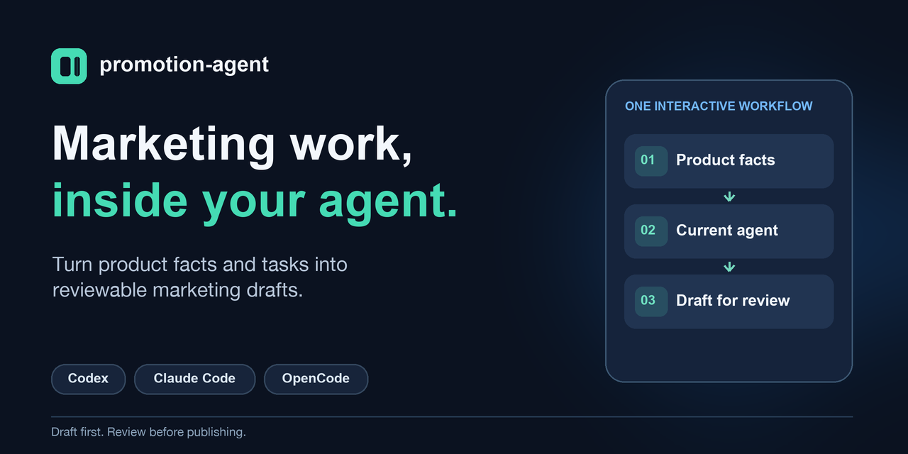

# promotion-agent

A marketing assistant for your projects, used through Codex, Claude Code, or OpenCode. It reads your product repository, prepares marketing work, and reviews it with you in conversation.

**Your product repository stays read only by default.** Drafts, research, tasks, and logs live in a separate private promotion workspace. Recommended product changes stay proposals until you ask the agent to apply them.

[Source on GitHub](https://github.com/apsquared/promotion-agent) · [MIT license](LICENSE)

## Get started

Requires Git, Node.js 22.14 or newer with npm, and Codex, Claude Code, or OpenCode. Install from source; the npm package is not published yet.

### 1. Get promotion-agent

Clone this repository and open its folder in your agent:

```sh
git clone https://github.com/apsquared/promotion-agent.git
```

Keep it separate from your product repositories. The agent handles dependency installation and building when needed.

### 2. Tell it which project to promote

In that chat, say:

```text
Set up promotion for my project Example Desk.
```

The agent finds your local project by name, verifies the match, creates a separate promotion workspace, and tells you where it saved it. If several checkouts match, it asks you to choose; you do not need to supply a filesystem path. The product name can differ from its folder, Git repository or package name; the agent checks identifying project metadata. Nothing is installed into your product repository. Setup keeps work in draft/review mode.

### 3. Ask for marketing work

Continue in the same chat:

```text
Draft one X post for this product.
```

Then review and revise naturally:

```text
Make it shorter and focus on the main benefit.
```

```text
What's the status?
```

For future chats, open the **promotion workspace** the agent created. It contains the workflow and your saved marketing work. If your agent does not discover the workflow, say “Read .promotion-agent/templates/WORKFLOW.md.”

No database, publishing account, or additional model API key is needed for drafting. Publishing, sending outreach, spending, committing, and pushing require separate authorization.

## What you can ask for

- “Prepare a directory submission kit.”
- “Find relevant discussions and draft helpful replies.”
- “Analyze our competitors and find where people discuss them.”
- “Propose a blog article.”
- “Recommend SEO improvements.”
- “Show me our drafts and pending work.”

This checkout also includes `reddit-thread-search` and `x-post-search` in `.agents/skills/`, with their query reference and search script. Use them to find relevant discussions for the selected product under the shared workflow. These copied skills are currently checkout resources; portable workspace onboarding does not install them.

The agent uses your product documentation and marketing history to support its claims. Drafts and recommendations remain available for review; preparing them does not publish anything.

## X account growth and coaching

Ask “Review @myhandle and create a customized X growth plan,” then “What should I do today?” or “Review this week’s results.” Use `$x-growth` in Codex or `/x-growth` in Claude Code/OpenCode. The shared procedure audits available account evidence, adapts the routine to your time budget, saves tasks and metrics, and revises the plan through ongoing coaching. Personal and brand accounts are supported; personal accounts need no product registration.

These entrypoints are checkout resources; portable onboarding does not install them yet. Account plans and analytics stay in private user data or the selected promotion workspace. Public actions and recurring reminders require applicable explicit authorization. See [X growth workflow](templates/activities/x-growth/WORKFLOW.md) and its [research sources](templates/activities/x-growth/research.md).

## Multiple projects

Repeat the setup request with another product's name. Each product gets its own workspace, context, tasks, drafts, and logs. One chat works on one selected product at a time.

Workspaces default to `~/.local/share/promotion-agent/projects/<UUID>/`. You can request a different location outside your product repositories. Keep workspaces private: they contain local paths and product-specific marketing records.

Existing marketing files in a product repo can be read as source material. Earlier product-local promotion-agent installations are left untouched; importing their history or removing their files is a separate request.

## Optional review desk

From a chat in this promotion-agent checkout, ask:

```text
Open the review desk for my promotion workspace at /absolute/path/to/workspace.
```

The local web app lists your tasks. Each task shows its description and one prompt to copy, labeled with where to paste it: your promotion-agent session, or an agent session in the product repository for `product` tasks. It does not execute actions or approve publication. See [review desk details](docs/REVIEW-UI.md).

## Development and details

```sh
npm ci
npm run check
```

The current agent performs the marketing work. Local helpers manage workspace files and evidence; there is no separate AI runner or background scheduler. Automated helper checks do not establish live native-menu or conversational behavior across all three hosts.

- [Usage and helper reference](docs/INTERACTIVE.md)
- [Architecture](docs/ARCHITECTURE.md)
- [Shared workflow](templates/WORKFLOW.md)
- [Manual smoke test](docs/MANUAL-SMOKE-TEST.md)
- [Compatibility](docs/COMPATIBILITY.md) and [release status](docs/RELEASE.md)
- [Plan](docs/PLAN.md), [handoff](docs/HANDOFF.md), and [contributing](CONTRIBUTING.md)


